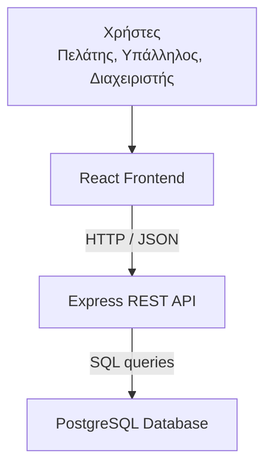

# Αρχιτεκτονική και Τεχνολογική Στοίβα

## 1. Αρχιτεκτονική συστήματος

Το SmartQueue ακολουθεί αρχιτεκτονική τριών επιπέδων:

1. Επίπεδο παρουσίασης – Frontend
2. Επίπεδο επιχειρησιακής λογικής – Backend
3. Επίπεδο δεδομένων – Database



### 1.1 Frontend

Το frontend αποτελεί τη διεπαφή μέσω της οποίας οι χρήστες
αλληλεπιδρούν με το SmartQueue.

Θα περιλαμβάνει:

- Αρχική σελίδα και προβολή υπηρεσιών.
- Έκδοση και παρακολούθηση εισιτηρίου.
- Σελίδα σύνδεσης υπαλλήλου και διαχειριστή.
- Πίνακα εργασίας υπαλλήλου.
- Πίνακα διαχείρισης υπηρεσιών, γκισέ και χρηστών.
- Προβολή στατιστικών.

Το frontend δεν επικοινωνεί απευθείας με τη βάση δεδομένων. Στέλνει
HTTP αιτήματα στο REST API και λαμβάνει απαντήσεις σε μορφή JSON.

### 1.2 Backend

Το backend υλοποιεί την επιχειρησιακή λογική της εφαρμογής.

Οι βασικές αρμοδιότητές του είναι:

- Έλεγχος και επεξεργασία των αιτημάτων.
- Επικύρωση δεδομένων.
- Αυθεντικοποίηση χρηστών.
- Έλεγχος πρόσβασης ανά ρόλο.
- Δημιουργία και διαχείριση εισιτηρίων.
- Επιλογή του επόμενου πελάτη.
- Υπολογισμός θέσης και χρόνου αναμονής.
- Επικοινωνία με τη βάση δεδομένων.
- Επιστροφή κατάλληλων HTTP responses.

### 1.3 Database

Η PostgreSQL αποθηκεύει μόνιμα τα δεδομένα του συστήματος.

Οι βασικές οντότητες είναι:

- `users`: υπάλληλοι και διαχειριστές.
- `services`: διαθέσιμες υπηρεσίες.
- `counters`: γκισέ εξυπηρέτησης.
- `queue_tickets`: εισιτήρια προτεραιότητας.
- `service_sessions`: καταγραφή των εξυπηρετήσεων.

## 2. Τεχνολογική στοίβα

### 2.1 React

Το React θα χρησιμοποιηθεί για την ανάπτυξη του frontend. Επιλέχθηκε
επειδή υποστηρίζει τη δημιουργία επαναχρησιμοποιήσιμων components και
τη δυναμική ενημέρωση της διεπαφής χωρίς επαναφόρτωση της σελίδας.

### 2.2 Vite

Το Vite θα χρησιμοποιηθεί για τη δημιουργία, ανάπτυξη και παραγωγική
μεταγλώττιση του React project. Παρέχει γρήγορο development server και
απλή διαδικασία build.

### 2.3 Node.js

Το Node.js θα χρησιμοποιηθεί ως περιβάλλον εκτέλεσης του backend.
Επιτρέπει τη χρήση JavaScript τόσο στο frontend όσο και στο backend.

### 2.4 Express

Το Express θα χρησιμοποιηθεί για την ανάπτυξη του REST API. Μέσω αυτού
θα οριστούν τα endpoints, τα middleware και οι κανόνες επεξεργασίας
των HTTP αιτημάτων.

### 2.5 PostgreSQL

Η PostgreSQL επιλέχθηκε ως σχεσιακή βάση δεδομένων λόγω της αξιοπιστίας
της, της υποστήριξης σχέσεων και constraints και της καταλληλότητάς
της για τα δομημένα δεδομένα του SmartQueue.

### 2.6 Jest και Supertest

Το Jest θα χρησιμοποιηθεί για Unit Tests, ενώ το Supertest θα
χρησιμοποιηθεί για αυτοματοποιημένο έλεγχο των API endpoints.

### 2.7 Git και GitHub

Το Git χρησιμοποιείται για την τοπική διαχείριση εκδόσεων. Το GitHub
φιλοξενεί το repository, τα branches και τα Pull Requests και θα
εκτελεί το CI/CD pipeline μέσω GitHub Actions.

### 2.8 Docker και Docker Compose

Το Docker θα πακετάρει τα τμήματα της εφαρμογής σε containers. Το
Docker Compose θα εκκινεί το frontend, το backend και την PostgreSQL ως
ένα ενιαίο local staging περιβάλλον.

## 3. Επικοινωνία εφαρμογής

Η επικοινωνία frontend και backend πραγματοποιείται με HTTP αιτήματα
και δεδομένα JSON.

Παράδειγμα δημιουργίας εισιτηρίου:

```http
POST /api/tickets
Content-Type: application/json
```

```json
{
  "serviceId": 1
}
```

Παράδειγμα επιτυχημένης απάντησης:

```json
{
  "id": 25,
  "ticketNumber": "A025",
  "status": "WAITING",
  "peopleAhead": 4
}
```

## 4. Ενδεικτικά REST API endpoints

| Μέθοδος | Endpoint | Λειτουργία |
|---|---|---|
| POST | `/api/auth/login` | Σύνδεση χρήστη |
| GET | `/api/services` | Προβολή ενεργών υπηρεσιών |
| POST | `/api/tickets` | Έκδοση εισιτηρίου |
| GET | `/api/tickets/:id` | Παρακολούθηση εισιτηρίου |
| PATCH | `/api/tickets/:id/cancel` | Ακύρωση εισιτηρίου |
| POST | `/api/queue/call-next` | Κλήση επόμενου πελάτη |
| PATCH | `/api/tickets/:id/complete` | Ολοκλήρωση εξυπηρέτησης |
| PATCH | `/api/tickets/:id/skip` | Παράλειψη πελάτη |
| POST | `/api/admin/services` | Δημιουργία υπηρεσίας |
| GET | `/api/admin/statistics` | Προβολή στατιστικών |

## 5. Ασφάλεια

Για την προστασία του συστήματος θα χρησιμοποιηθούν:

- Hashing κωδικών πρόσβασης.
- JSON Web Tokens για αυθεντικοποίηση.
- Έλεγχος πρόσβασης ανά ρόλο.
- Επικύρωση όλων των δεδομένων εισόδου.
- Environment variables για ευαίσθητες ρυθμίσεις.
- Parameterized SQL queries.
- Περιορισμένη έκθεση πληροφοριών στα μηνύματα σφάλματος.

## 6. Προτεινόμενη δομή project

```text
SmartQueue/
├── backend/
│   ├── src/
│   │   ├── config/
│   │   ├── controllers/
│   │   ├── middleware/
│   │   ├── repositories/
│   │   ├── routes/
│   │   ├── services/
│   │   └── tests/
│   └── package.json
├── frontend/
│   ├── src/
│   │   ├── components/
│   │   ├── pages/
│   │   └── services/
│   └── package.json
├── database/
├── docs/
├── .github/
│   └── workflows/
├── docker-compose.yml
├── AGENTS.md
├── PLANNING.md
├── README.md
└── TASKS.md
```